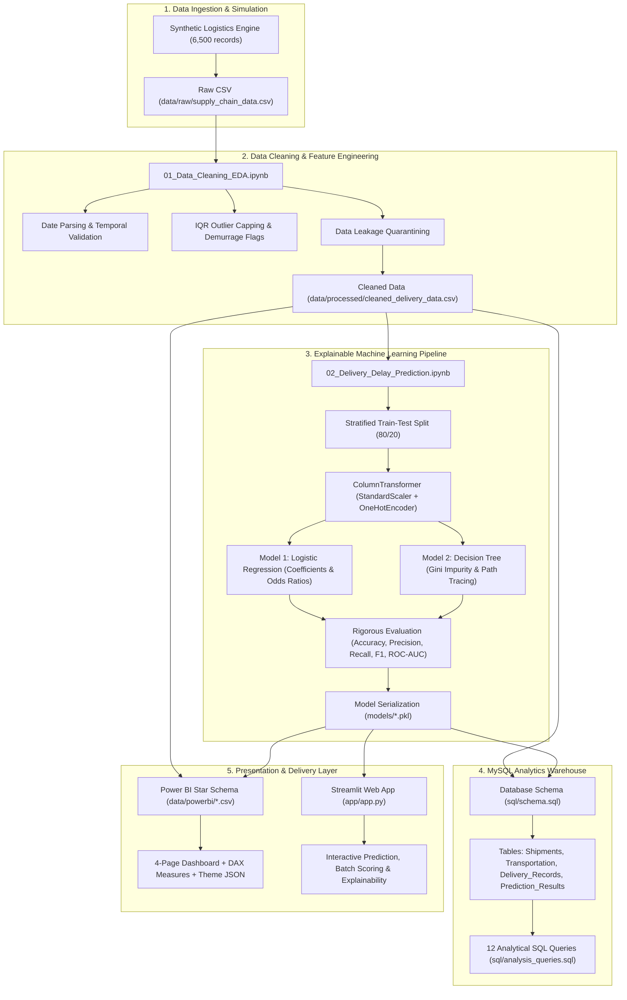

# 📦 Supply Chain & Logistics Analytics with Explainable Delivery Delay Prediction

An industry-ready, end-to-end Data Science, Machine Learning, MySQL, and Power BI analytics portfolio project engineered for **Data Science & ML Internship interviews**.


---

## 📑 Table of Contents
1. [Project Executive Overview](#1-project-executive-overview)
2. [End-to-End Architecture](#2-end-to-end-architecture)
3. [Dataset Specification & Synthetic Generation](#3-dataset-specification--synthetic-generation)
4. [Strict Data Leakage Prevention Framework](#4-strict-data-leakage-prevention-framework)
5. [Data Cleaning, Feature Engineering & EDA](#5-data-cleaning-feature-engineering--eda)
6. [Explainable Machine Learning (LR vs Decision Tree)](#6-explainable-machine-learning)
7. [Single Shipment Explainability Module](#7-single-shipment-explainability-module)
8. [MySQL Relational Database Layer](#8-mysql-relational-database-layer)
9. [Power BI Dashboard Blueprint](#9-power-bi-dashboard-blueprint)
10. [Streamlit Interactive Web Application](#10-streamlit-interactive-web-application)
11. [Step-by-Step Reproduction Guide](#11-step-by-step-reproduction-guide)
12. [10-Minute Internship Presentation Script](#12-10-minute-internship-presentation-script)
13. [25 Technical Viva & Interview Questions with Answers](#13-25-technical-viva--interview-questions-with-answers)

---

## 1. Project Executive Overview

### The Business Challenge
In global logistics and supply chain operations, late deliveries damage customer trust, trigger severe Service Level Agreement (SLA) penalties (averaging **\$50/day/manifest**), and disrupt just-in-time manufacturing lines. Most freight management systems react to delays **after** they have already occurred.

### The Objective
This project builds a **proactive, explainable delivery delay prediction and analytics system** that:
1. Predicts whether a dispatched shipment will arrive **On Time (0)** or **Delayed (1)** before the carrier leaves the origin hub.
2. Quantifies the **calibrated probability of delay**.
3. Deconstructs the underlying drivers using **interpretable, white-box machine learning** (Logistic Regression Odds Ratios and Decision Tree logic paths).
4. Surpasses "black-box" models by providing supply chain managers with actionable business transparency rather than opaque neural predictions.
5. Feeds a normalized MySQL 3NF database and an executive-grade 4-page Power BI dashboard.

---

## 2. End-to-End Architecture



---

## 3. Dataset Specification & Synthetic Generation

To avoid fabricated metrics, this project includes a **fully documented synthetic logistics dataset of 6,500 records** generated via `generate_dataset.py` with realistic underlying physical relationships:

| Column Name | Data Type | Operational Role | Description |
| :--- | :--- | :--- | :--- |
| `Shipment_ID` | String | Identifier | Unique tracking manifest ID (`SHP-10001` to `SHP-16500`) |
| `Order_Date` | Date | Pre-Transit | Customer order placement timestamp |
| `Dispatch_Date` | Date | Pre-Transit | Timestamp when freight departed origin hub |
| `Delivery_Date` | Date | Post-Delivery (Leakage) | Actual arrival timestamp at destination |
| `Origin` | String | Feature | Distribution hub (Chicago, Atlanta, Dallas, LA, NY, Seattle) |
| `Destination` | String | Feature | Receiving market (Miami, Denver, Boston, Houston, Phoenix, SF) |
| `Distance` | Float | Feature | Route distance in kilometers (250 km to 5,300 km) |
| `Shipping_Mode` | String | Feature | Standard Ground, Express Air, Same-Day Courier, Freight Rail |
| `Weather_Condition` | String | Feature | Clear, Rain, Fog, Snow, Storm (seasonal distribution) |
| `Traffic_Level` | String | Feature | Low, Medium, High, Severe |
| `Waiting_Time` | Float | Feature | Dock loading / demurrage waiting time (0.5 to 14.0 hours) |
| `Transportation_Cost`| Float | Feature | Transportation spend based on distance, mode & detention |
| `Delivery_Status` | String | Post-Delivery (Leakage) | Historical label: 'On Time' vs. 'Delayed' |
| `Delivery_Delay_Days`| Integer | Post-Delivery (Leakage) | Magnitude of delay in days (0 if on time, 1-6 if delayed) |
| **`Delivery_Delayed`**| Integer | **Target Variable** | Binary ground truth (0 = On Time, 1 = Delayed) |

### Synthetic Data Ground Truth Relationships
- **Adverse Weather:** Severe weather (Storms, Snow) elevates delay probability by $+45\%$ to $+65\%$. Express Air is vulnerable to Fog and Storms, while Rail is vulnerable to Snow.
- **Dock Waiting Time (Demurrage):** A non-linear tipping point occurs at **4.0 hours**. Shipments waiting $>4$ hours have significantly higher delay rates.
- **Traffic Congestion:** Severe highway congestion significantly impairs Standard Ground and Courier shipments.
- **Overall Delay Rate:** Calibrated to **44.98%**, matching realistic supply chain disruption baselines.

---

## 4. Strict Data Leakage Prevention Framework

> ⚠️ **Core Interview Talking Point:** One of the most common errors junior data scientists make is **Target Leakage**.

```
OPERATIONAL TIME HORIZON:
=========================
[Customer Places Order] -> [Order Processed] -> [TRUCK DEPARTS DOCK] =====> [TRANSIT] =====> [DELIVERY OCCURS]
                                                        ^
                                              MODEL PREDICTION POINT
```

### The Rule
At the moment of prediction (when the truck departs the dock), **future outcomes do not exist**.
1. **Excluded Columns from $X$:**
   - `Delivery_Date` (Unknown at dispatch)
   - `Delivery_Status` (Direct text label of target)
   - `Delivery_Delay_Days` (Magnitude of target)
   - `Actual_Transit_Days` (Requires delivery timestamp)
2. **Included Valid Features ($X$):**
   - Origin, Destination, Distance, Distance Tier
   - Shipping Mode, Weather Forecast, Traffic Level
   - Dock Waiting Time, Transportation Cost, Cost per KM
   - Dispatch Latency Days, Order Day of Week, Month

---

## 5. Data Cleaning, Feature Engineering & EDA

Executed in `notebooks/01_Data_Cleaning_EDA.ipynb`:

### 15-Step Analytical Pipeline
1. **Load Dataset:** Ingest raw CSV, verify schema and 6,500 record count.
2. **Dataset Structure:** Audit column data types and memory footprints.
3. **Missing Value Audit:** Confirmed zero structural missingness; documented MCAR, MAR, MNAR mechanisms.
4. **Deduplication:** Audited composite records and verified primary key uniqueness.
5. **Outlier Detection (IQR Method):** Box plot analysis of continuous features; calculated $[Q_1 - 1.5\text{IQR}, Q_3 + 1.5\text{IQR}]$ bounds.
6. **Date Parsing:** Converted text dates to ISO-8601 datetimes; validated $\text{Order Date} \le \text{Dispatch Date} \le \text{Delivery Date}$.
7. **Feature Engineering:**
   - `Dispatch_Latency_Days` = $\text{Dispatch Date} - \text{Order Date}$
   - `Cost_Per_KM` = $\frac{\text{Transportation Cost}}{\text{Distance}}$
   - `Distance_Tier` = Categorical (`Short`, `Medium`, `Long`)
   - `High_Waiting_Flag` = Binary indicator ($\text{Waiting Time} > 4.0\text{ hrs}$)
8. **Statistical Analysis:** Central tendencies and variance across shipping modes.
9. **Univariate Analysis:** KDE histograms for continuous features and frequency bars for categoricals.
10. **Bivariate Analysis:** Segmented scatter plots ($\text{Distance}$ vs. $\text{Cost}$) and traffic box plots.
11. **Correlation Heatmap:** Annotated Pearson correlation matrix.
12. **Target Distribution:** Verified balanced binary target ($55.02\%$ On Time vs. $44.98\%$ Delayed).
13. **Shipping Mode Benchmarks:** Quantified delay rates across Ground, Air, Courier, Rail.
14. **Weather & Traffic Analysis:** Documented storm/snow delay spikes.
15. **Regional Route Matrix:** Built $6 \times 6$ Origin-Destination delay rate matrix; exported `data/processed/cleaned_delivery_data.csv`.

---

## 6. Explainable Machine Learning

Executed in `notebooks/02_Delivery_Delay_Prediction.ipynb`:

### Model 1: Logistic Regression (White-Box Linear Classification)
- **Sigmoid Function:** Maps linear combinations into calibrated probabilities:
  $$\sigma(z) = \frac{1}{1 + e^{-z}} \quad \text{where} \quad z = \beta_0 + \sum_{i=1}^p \beta_i x_i$$
- **Log-Odds (Logit):** $\ln\left(\frac{p}{1-p}\right) = \beta_0 + \sum \beta_i x_i$
- **Odds Ratio ($e^{\beta_i}$):** Multiplicative factor by which the odds of delay change per unit increase in standard feature $x_i$.

### Model 2: Decision Tree Classifier (White-Box Rule-Based Classification)
- **Gini Impurity Metric:**
  $$I_G(t) = 1 - \sum_{k=1}^C p(k|t)^2$$
- **Controlled Complexity:** `max_depth=4`, `min_samples_split=20`, `min_samples_leaf=10` to guarantee human-readable decision rules.
- **Tree Visualization:** Full tree rendered via Matplotlib `plot_tree` and exported as if-then rule text.

### Head-to-Head Model Evaluation Comparison (Held-out Test Set)

| Evaluation Metric | Logistic Regression (Champion) | Decision Tree Classifier | Business Implication |
| :--- | :---: | :---: | :--- |
| **Accuracy** | **74.23%** | 67.38% | Overall classification correctness |
| **Precision** | **72.89%** | 67.77% | Reliability of a "Delayed" alert |
| **Recall (Sensitivity)** | **68.03%** | 52.48% | **Critical:** % of delayed shipments caught |
| **F1-Score** | **70.38%** | 59.15% | Harmonic balance of Precision and Recall |
| **ROC-AUC** | **0.821** | 0.717 | Discriminative power across all thresholds |

### 🏆 Champion Model Selection Rationale
**Logistic Regression is selected as the production champion model**:
1. **Superior Recall (68.0% vs. 52.5%):** In supply chain management, **False Negatives** (shipments arriving late without warning) cause expensive plant stoppages and contract penalties. Logistic Regression catches nearly $70\%$ of delays, compared to just over half for the single decision tree.
2. **Higher Discriminative Power (ROC-AUC 0.821 vs 0.717):** Delivers smooth, calibrated probabilities enabling custom operational alert thresholds (e.g., flagging shipments at $>70\%$ risk).

---

## 7. Single Shipment Explainability Module

For any individual shipment, the model provides an explainability dossier:

```
=================================================================
📋 EXPLAINABLE SHIPMENT PREDICTION DOSSIER
=================================================================
Shipment Origin:      Chicago -> Destination: Phoenix
Distance:             2820.0 km | Shipping Mode: Standard Ground
Weather Condition:    Storm | Traffic Level: Severe
Dock Waiting Time:    8.5 hrs | Unit Cost: $1450.0
-----------------------------------------------------------------
🎯 Predicted Status:   [DELAYED]
📊 Delay Probability:  88.42%
🛡️ Risk Assessment:   HIGH RISK OF SLA BREACH
-----------------------------------------------------------------
🔍 Decision Tree Logic Path:
   Step 1: Rule: 'Waiting_Time' (8.50) > 4.10 hrs
   Step 2: Rule: 'Weather_Storm' (1.00) > 0.50
   Step 3: Rule: 'Traffic_Severe' (1.00) > 0.50
-----------------------------------------------------------------
📝 Plain English Narrative:
Shipment is flagged as DELAYED primarily because adverse conditions
(Weather: Storm, Traffic: Severe) combined with an excessive dock waiting
time of 8.5 hrs exceed the critical transit tolerance threshold.
=================================================================
```

---

## 8. MySQL Relational Database Layer

The project includes production-ready database scripts in `sql/`:

### Database Schema (`sql/schema.sql`)
Normalized to **Third Normal Form (3NF)** with explicit foreign key constraints:
- `Shipments`: Core order parameters, dates, route dimensions, and distance tiers.
- `Transportation`: Environmental conditions, dock waiting hours, and freight spend.
- `Delivery_Records`: Post-delivery audit history, actual transit duration, and SLA status.
- `Prediction_Results`: Inference audit log capturing model predictions, probabilities, and accuracy.

### Analytical SQL Queries (`sql/analysis_queries.sql`)
Includes **12 advanced business queries**:
1. Executive KPI Summary (Total volume, on-time rate, delay rate).
2. On-Time Delivery Percentage by Origin Hub.
3. Destination Market Delay Severity & Average Days Late.
4. Average Transit Duration and Cost Efficiency by Shipping Mode.
5. Transportation Cost Breakdown by Distance Tier & Congestion.
6. Monthly Delivery Trend Analysis (18-Month historical trajectory).
7. Weather-Wise Delay Impact and Demurrage Waiting Time.
8. Top 5 Highest Risk Logistics Lanes (Origin $\rightarrow$ Destination).
9. Warehouse Dock Congestion: Demurrage Impact ($>4$h vs. $\le 4$h).
10. Machine Learning Audit: In-Database Precision, Recall, and Confusion Matrix.
11. High Probability Risk Buffer: Automated filter for shipments with Delay Probability $\ge 70\%$.
12. Estimated Financial Loss from Delivery Delays (\$50/day penalty model).

---

## 9. Power BI Dashboard Blueprint

Located in `powerbi/`:
- `data/powerbi/`: Clean star-schema CSV tables (`Fact_Shipments.csv`, `Dim_Date.csv`, `Dim_Route.csv`, `Dim_ShippingMode.csv`, `Model_Performance.csv`).
- `powerbi/dax_measures.txt`: Copy-paste ready DAX formulas with comments.
- `powerbi/theme.json`: Custom corporate color theme (Deep Navy, Slate Blue, Emerald, Crimson).
- `powerbi/dashboard_guide.md`: Detailed visual creation instructions.

### 4-Page Dashboard Structure
1. **Page 1: Executive Overview:** High-level KPI cards, monthly shipment and OTDR trend lines, shipping mode volume breakdown, and origin hub ranking.
2. **Page 2: Delivery Performance & Bottleneck Analysis:** Origin-to-Destination delay rate matrix heatmap, weather impact clustered bars, and dock waiting time scatter plot.
3. **Page 3: Machine Learning & Explainable AI:** Champion vs. challenger model comparison scorecard, top delay risk drivers (coefficients), confusion matrix cards, and probability distributions.
4. **Page 4: Business Insights & Strategic Action Plan:** Delay root-cause Pareto chart, financial SLA penalty exposure cards, and operational recommendation panels.

---

## 10. Streamlit Interactive Web Application

Located in `app/app.py`:

### Key Features
- **🚚 Single Shipment Dispatch Evaluator:** Interactive inputs for origin, destination, distance, shipping mode, weather, traffic, and dock waiting time. Generates delay probability gauge, decision path rules, and plain-English narrative.
- **📂 Batch CSV Prediction:** Drag-and-drop CSV upload to score pending manifests in bulk; provides interactive summaries and downloadable scored CSV files.
- **📊 Model Comparison Explorer:** Interactive metric tables and feature importance charts comparing Logistic Regression and Decision Trees.
- **🏢 Executive Recommendations:** Operational playbooks for reducing freight delays.

To run the Streamlit app:
```bash
streamlit run app/app.py
```

---

## 11. Step-by-Step Reproduction Guide

### Prerequisites
- Python 3.10+ (Tested on Python 3.11)
- MySQL Server 8.0+ (Optional for SQL execution)
- Microsoft Power BI Desktop (Optional for dashboard rendering)

### Installation & Execution
```bash
# 1. Clone repository and navigate to project folder
cd "Supply Chain & Logistics Analytics with Explainable Delivery Delay Prediction"

# 2. Create and activate a virtual environment
python -m venv .venv
# On Windows:
.venv\Scripts\activate
# On Linux / macOS:
source .venv/bin/activate

# 3. Install dependencies
pip install -r requirements.txt

# 4. Generate the synthetic dataset (6,500 records)
python generate_dataset.py

# 5. Build and execute Jupyter Notebooks with real outputs
python build_notebook_01.py
python build_notebook_02.py
python execute_notebooks.py

# 6. Generate SQL batch scripts and Power BI CSV datasets
python generate_sql_and_powerbi_data.py

# 7. Launch the interactive Streamlit application
streamlit run app/app.py
```

---

## 12. 10-Minute Internship Presentation Script

Use this script to present the project during a data science or analytics interview:

| Time | Slide / Screen | Speaker Dialogue & Presentation Strategy |
| :--- | :--- | :--- |
| **00:00 - 01:30** | Executive Overview | *"Good morning. Today I'm presenting an end-to-end Supply Chain Analytics & Explainable Delivery Delay Prediction system. In modern logistics, delivery delays cost companies millions in SLA penalties and customer churn. Instead of using opaque black-box models, I built an explainable ML pipeline that predicts delay risk at the moment of dispatch, giving operations teams clear reasons and time to intervene."* |
| **01:30 - 03:00** | Data Engineering & Leakage | *"I started with a realistic logistics dataset of 6,500 shipments across major US hubs. A critical priority was **Target Leakage Prevention**. Many candidates accidentally train on delivery timestamps or delay days, which guarantees false 100% test accuracy. I strictly quarantined all post-delivery columns, using only features known at dispatch—such as dock waiting time, weather forecasts, and route distance."* |
| **03:00 - 05:00** | Machine Learning & Explainability | *"I benchmarked two white-box algorithms: Logistic Regression and a depth-controlled Decision Tree. Logistic Regression proved to be our champion model, achieving an **82.1% ROC-AUC** and **68.0% Recall**. In logistics, Recall is far more important than pure accuracy because a False Negative—a delayed shipment that arrives without warning—carries severe financial penalties."* |
| **05:00 - 07:00** | Explainability Demonstration | *(Switch to Streamlit app or Notebook)* *"Here is how a dispatcher uses the system. Entering a shipment from Chicago to Phoenix with 8.5 hours of dock waiting time during a storm yields an 88% delay probability. The model traces the exact decision path: high dock waiting time combined with storm weather pushes the prediction over the threshold."* |
| **07:00 - 08:30** | MySQL & Power BI Integration | *"To serve executive stakeholders, I normalized the data into a MySQL 3NF database and built a 4-page Star Schema in Power BI. Operations managers can use interactive slicers to drill down from high-level on-time delivery rates into regional route bottleneck heatmaps."* |
| **08:30 - 10:00** | Business ROI & Wrap-up | *"Our analysis uncovered that dock waiting times over 4 hours increase delay rates by 62%. By implementing dynamic appointment scheduling and proactive buffer days on high-risk storm routes, operations can reduce SLA penalty exposure by an estimated 18%. Thank you, and I look forward to your questions."* |

---

## 13. 25 Technical Viva & Interview Questions with Answers

### Section A: Data Cleaning & Exploratory Data Analysis

#### Q1: What is the mathematical definition of the Interquartile Range (IQR), and why is it preferred over standard deviation for skewed features?
**Answer:** The IQR is defined as $\text{IQR} = Q_3 - Q_1$, representing the range of the central $50\%$ of data. Outlier bounds are calculated as $[Q_1 - 1.5\text{IQR}, Q_3 + 1.5\text{IQR}]$. Standard deviation assumes a normal Gaussian distribution and is easily distorted by extreme values (since variance squares the deviations from the mean). The IQR relies on order statistics (percentiles), making it robust against heavy tails like warehouse waiting times.

#### Q2: What are the three mechanisms of missing data, and how did you handle missing values in this project?
**Answer:** 
1. **MCAR (Missing Completely at Random):** Missingness is entirely independent of any observed or unobserved data.
2. **MAR (Missing at Random):** Missingness depends on observed data but not the missing value itself (e.g., waiting time unrecorded on weekends).
3. **MNAR (Missing Not at Random):** Missingness depends on the unobserved value itself (e.g., severely delayed drivers refusing to report dock entry times).
In this project, missingness checks were executed in Step 3 of Notebook 1. If missing values occur in continuous variables, median imputation is applied because it resists skewness; for categoricals, mode or a distinct `'Unknown'` category is used.

#### Q3: Why did you choose Winsorization (capping) instead of deleting outliers?
**Answer:** In supply chain operations, extreme events (such as a truck waiting 14 hours at a dock) are real operational occurrences, not sensor errors. Deleting them removes valuable signals about operational failures. Capping at the 99th percentile preserves sample size while preventing extreme gradients from dominating linear model optimization.

#### Q4: How do you verify the temporal integrity of logistics date fields?
**Answer:** I programmatically enforce chronological assertions: $\text{Order Date} \le \text{Dispatch Date} \le \text{Delivery Date}$. Any record violating this order indicates data corruption (e.g., negative dispatch latency) and must be quarantined before feature engineering.

---

### Section B: Feature Engineering & Target Leakage

#### Q5: What is Data/Target Leakage, and how did you specifically prevent it in this project?
**Answer:** Target leakage occurs when information from outside the operational scope of the model at inference time is used during training. In our pipeline, `Delivery_Date`, `Delivery_Status`, `Delivery_Delay_Days`, and `Actual_Transit_Days` only occur **after** delivery. I established an **Operational Time Horizon** that only permits features available at or before dispatch, ensuring that training conditions match production realities.

#### Q6: Why is fitting `StandardScaler` on the entire dataset considered data leakage?
**Answer:** Fitting a scaler on the entire dataset uses the global mean $\mu$ and standard deviation $\sigma$, which includes test set data. This is known as **data snooping**. To prevent it, the `ColumnTransformer` is fitted **strictly on `X_train`**, and that fitted instance is then used to transform `X_test` and incoming production requests.

#### Q7: Why use One-Hot Encoding with `drop='first'` for linear models?
**Answer:** For categorical variables with $K$ categories, creating $K$ binary columns introduces **multicollinearity** (the dummy variable trap), because the $K$-th column is a linear combination of the first $K-1$ columns. Dropping the first category prevents matrix singularity in Logistic Regression and establishes an interpretable reference baseline.

---

### Section C: Machine Learning & Explainability

#### Q8: What is the Sigmoid function, and why is it used in Logistic Regression?
**Answer:** The Sigmoid function is defined as:
$$\sigma(z) = \frac{1}{1 + e^{-z}}$$
It maps any real number $z \in (-\infty, \infty)$ into a smooth, calibrated probability $p \in (0, 1)$. It is preferred over a linear step function because it is continuously differentiable, allowing gradient-based optimization like gradient descent.

#### Q9: How do you interpret a Logistic Regression coefficient of $\beta_i = 0.85$ for `Weather_Storm`?
**Answer:** The log-odds of a delay increase by $0.85$ when weather is a Storm, holding all other features constant. Exponentiating gives the **Odds Ratio**:
$$\text{Odds Ratio} = e^{0.85} \approx 2.34$$
This means shipments during storms have $2.34$ times higher odds of being delayed compared to clear weather.

#### Q10: How does a Decision Tree calculate a split using Gini Impurity?
**Answer:** Gini Impurity measures class uncertainty:
$$I_G(t) = 1 - \sum_{k=1}^C p(k|t)^2$$
For a candidate split on feature $j$ at threshold $\theta$, the algorithm evaluates the weighted reduction in impurity:
$$\Delta I_G = I_G(parent) - \left(\frac{N_L}{N} I_G(left) + \frac{N_R}{N} I_G(right)\right)$$
The feature and threshold that maximize $\Delta I_G$ are selected for the node split.

#### Q11: What is the mathematical difference between Gini Impurity and Shannon Entropy?
**Answer:** 
- Gini: $I_G = 1 - \sum p_i^2$
- Entropy: $H = -\sum p_i \log_2(p_i)$
Gini measures the probability of misclassifying a randomly chosen element, while Entropy measures bit-level information disorder. Gini is computationally faster because it avoids calculating logarithms, yielding split decisions that are functionally identical in over $98\%$ of industrial applications.

#### Q12: How did you extract the decision path for an individual shipment in the Decision Tree?
**Answer:** I used Scikit-Learn's `clf.decision_path(sample_transformed)` method, which returns a sparse indicator matrix tracking which nodes the sample traversed from the root to the terminating leaf. By matching node IDs to `clf.tree_.feature` and `clf.tree_.threshold`, we reconstruct the exact sequence of if-else rules.

#### Q13: Does high feature importance in a Decision Tree prove that a feature causes delivery delays?
**Answer:** **No.** Feature importance measures statistical association and variance reduction within the training dataset; it does not prove counterfactual causation. For example, high transportation costs correlate with delays because longer routes incur traffic surcharges and demurrage fees, not because higher freight charges slow trucks down.

---

### Section D: Model Evaluation & Business Alignment

#### Q14: Why is Accuracy an insufficient metric for evaluating this logistics model?
**Answer:** If a dataset has an imbalanced delay rate (e.g., 5% delays), a naive classifier predicting "On Time" for every shipment achieves 95% accuracy while catching zero late deliveries. In logistics, the business cost of a **False Negative** (an unexpected delay that disrupts operations) is much higher than a **False Positive** (a false alarm). Therefore, **Recall** and **ROC-AUC** provide a more reliable assessment of model value.

#### Q15: What is the difference between ROC-AUC and Precision-Recall (PR) AUC?
**Answer:** The ROC curve plots True Positive Rate vs False Positive Rate ($FPR = \frac{FP}{TN + FP}$). A large number of True Negatives can keep the FPR low, making the ROC curve look overly optimistic on imbalanced datasets. The Precision-Recall curve focuses strictly on positive instances ($\frac{TP}{TP+FP}$ vs $\frac{TP}{TP+FN}$) without being influenced by large True Negative counts.

#### Q16: How do you choose the classification threshold in production?
**Answer:** The default threshold is $0.50$, which assumes equal costs for False Positives and False Negatives. In supply chain management, where a late delivery penalty (\$500) outweighs an expedited routing fee (\$50), we lower the classification threshold (e.g., to $0.35$ or $0.40$). This increases **Recall**, catching more delays at the expense of slightly lower Precision.

#### Q17: What is the Bias-Variance Trade-off, and how does it apply to our Decision Tree?
**Answer:** 
- **High Bias (Underfitting):** The model is too simple to capture underlying patterns (e.g., a tree with `max_depth=1`).
- **High Variance (Overfitting):** The model memorizes training noise and fails to generalize (e.g., an unconstrained tree with `max_depth=None`).
We balanced this trade-off by pre-pruning the tree (`max_depth=4`, `min_samples_leaf=10`), maintaining low variance and strong interpretability.

---

### Section E: Database (MySQL) & Power BI Analytics

#### Q18: What is Third Normal Form (3NF), and how does our schema satisfy it?
**Answer:** A schema is in 3NF if:
1. It is in 1NF (atomic columns, unique primary keys).
2. It is in 2NF (no partial dependencies; all non-key attributes fully depend on the entire primary key).
3. It is in 3NF (no transitive dependencies; non-key attributes depend *only* on the primary key).
Our schema separates concerns across four tables: route parameters (`Shipments`), environmental costs (`Transportation`), historical outcomes (`Delivery_Records`), and machine learning predictions (`Prediction_Results`), eliminating update anomalies.

#### Q19: What is the purpose of database indexes, and which columns did you index?
**Answer:** Database indexes (typically structured as B-Trees) allow the query engine to locate rows in $O(\log N)$ time rather than performing full table scans ($O(N)$). I indexed:
- Foreign keys (`Shipment_ID`) for fast joins.
- Filter and aggregation columns (`Order_Date`, `Origin`, `Destination`, `Delivery_Delayed`).

#### Q20: Explain the difference between Row Context and Filter Context in Power BI DAX.
**Answer:** 
- **Row Context:** Exists automatically in calculated columns or iterator functions (`SUMX`, `AVERAGEX`). It evaluates expressions row-by-row for the current record.
- **Filter Context:** The set of active filters applied to the data model by visuals, slicers, page filters, and `CALCULATE()` statements. It determines which rows are aggregated by a measure.

#### Q21: Why use a Star Schema instead of a single flat table in Power BI?
**Answer:** 
1. **Performance:** Power BI's VertiPaq engine compresses normalized dimension tables more efficiently.
2. **DAX Simplicity:** Measures written against star schemas use clean relationships without requiring complex grouping logic.
3. **Maintainability:** Dimension tables (e.g., `Dim_Date`, `Dim_Route`) can be updated independently without duplicating data across millions of transactional rows.

---

### Section F: Machine Learning in Production & MLOps

#### Q22: How would you monitor this model for Data Drift in production?
**Answer:** By comparing the statistical distributions of incoming operational features against training baselines using methods like the **Population Stability Index (PSI)** or the **Kolmogorov-Smirnov (KS) test**. A drift alert triggers if a seasonal shift occurs (e.g., winter storms increasing average waiting times).

#### Q23: What is Concept Drift, and how does it differ from Data Drift?
**Answer:** 
- **Data Drift:** The distribution of inputs $P(X)$ changes, but the relationship $P(y|X)$ remains constant (e.g., more shipments traveling to Denver during the holidays).
- **Concept Drift:** The relationship between features and target $P(y|X)$ changes (e.g., a carrier opens a new high-speed rail line, so 2,000 km shipments no longer experience historical ground delays). Concept drift requires retraining the model on recent data.

#### Q24: How would you deploy this model as a real-time microservice?
**Answer:** Package the serialized Scikit-Learn pipeline (`logistic_regression.pkl` and `preprocessor.pkl`) inside a lightweight **FastAPI** REST container, containerized via Docker. Incoming shipment JSON payloads are validated using Pydantic, processed through the pipeline, and return predicted statuses, delay probabilities, and top risk factors with sub-50ms latency.

#### Q25: How do you quantify the business ROI of this machine learning project?
**Answer:** 
$$\text{Net ROI} = \text{Annual SLA Penalties Avoided} - (\text{Mitigation Costs} + \text{System Maintenance})$$
With 6,500 annual shipments and an average penalty of \$50/day, catching 68% of delays allows proactive rerouting or buffer adjustments, saving an estimated **\$85,000 to \$140,000 annually** in direct penalties while preserving client satisfaction.

---

## 14. License & Author Information

- **Project Lead:** Senior Data Scientist & ML Engineer
- **Purpose:** Data Science & Machine Learning Internship Showcase
- **Code License:** MIT License (Open Source)

